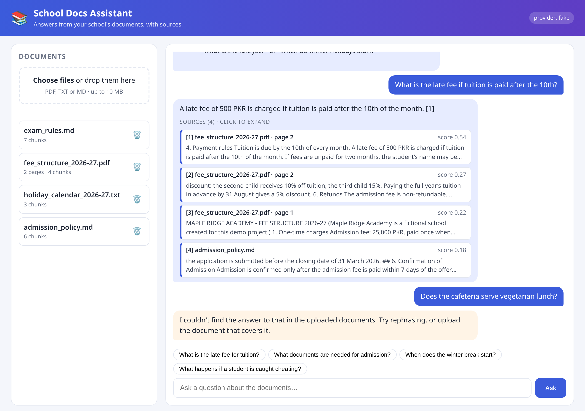
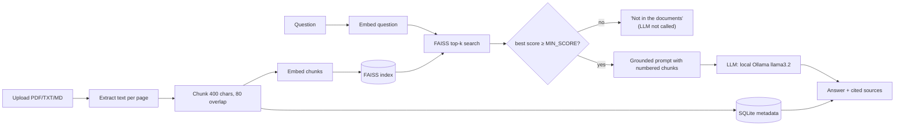

<div align="center">

# 📚 School Docs Assistant

**Ask questions about your school's documents and get answers that cite the exact file and page.**

[](https://www.python.org/)
[](https://fastapi.tiangolo.com/)
[](https://github.com/ahsannafees903/school-docs-rag-assistant/actions/workflows/ci.yml)
[](LICENSE)

</div>

Parents ask the same questions every term: *What's the late fee? Which documents do I need
for admission? When does winter break start?* The answers are in PDFs nobody reads.
**School Docs Assistant** is a retrieval-augmented generation (RAG) chatbot: upload the
admission policy, fee structure, exam rules and holiday calendar, then ask in plain English.
Every answer comes with its sources, and if the documents don't cover the question it says
so instead of making something up.


<sub>Screenshot taken with the offline `fake` provider, which answers by quoting the retrieved text.</sub>

## ✨ Features

- **Upload PDF, TXT or Markdown.** Text is extracted per page with `pypdf`, split into
  overlapping chunks and embedded.
- **Answers with citations:** document name, page number (for PDFs), snippet and similarity score.
- **Grounded by design.** Below a similarity threshold the assistant refuses *before*
  calling the LLM, and the system prompt forbids going beyond the retrieved context.
- **Runs fully local.** Default models are Ollama **`llama3.2:3b`** (chat) and
  **`nomic-embed-text`** (embeddings). No paid API key. On a 16 GB RAM machine you can
  switch the chat model to `llama3.1:8b`.
- **Offline fake provider** so the whole test suite and CI run with no Ollama process,
  no API key and no network.
- **FAISS vector index + SQLite metadata**, persisted to disk; deleting a document removes exactly its vectors.
- **Optional hybrid retrieval.** `RETRIEVAL_MODE=hybrid` blends the FAISS score with a BM25 keyword score. The default stays vector-only.
- **One JSON envelope for every response**, errors included ([API standards](docs/API_STANDARDS.md)).
- **Single-page chat UI** (plain HTML/JS, no build step) with drag-and-drop upload.
- **Retrieval eval script** reporting hit rate and refusal rate, plus a threshold sweep.
- Structured JSON logs, type hints, ruff, pytest, GitHub Actions, Docker + docker-compose.

## 🏗️ How it works



More detail: [docs/ARCHITECTURE.md](docs/ARCHITECTURE.md) · design trade-offs:
[docs/DECISIONS.md](docs/DECISIONS.md).

## 🚀 Quickstart

Requires Python 3.11+.

```bash
git clone https://github.com/ahsannafees903/school-docs-rag-assistant.git
cd school-docs-rag-assistant
python -m venv .venv && source .venv/bin/activate   # Windows: .venv\Scripts\activate
pip install -e ".[dev]"
cp .env.example .env
```

## Runs fully local, no paid API key

The default provider is Ollama on your machine. Copying `.env.example` does not ask for
an API key, and the running app does not send one. `PROVIDER=openai` is deprecated.

1. Install [Ollama](https://ollama.com) and leave it running (`ollama serve` if it is not already).
2. Pull the two models the defaults expect:

```bash
ollama pull llama3.2:3b
ollama pull nomic-embed-text
```

On a machine with **16 GB of RAM** you can use a stronger chat model instead. Embeddings stay the same:

```bash
ollama pull llama3.1:8b
# in .env: OLLAMA_CHAT_MODEL=llama3.1:8b
```

3. Ingest the four sample school documents and start the API (`.env` already has `PROVIDER=ollama`):

```bash
python scripts/ingest_samples.py                 # load the 4 sample school documents
uvicorn app.main:create_app --factory --reload   # open http://localhost:8000
```

4. Ask something the sample docs actually contain. Open http://localhost:8000 or:

```bash
curl -X POST http://localhost:8000/chat \
  -H "Content-Type: application/json" \
  -d '{"question": "What is the late fee if tuition is paid after the 10th?"}'
```

Other questions to try:

- Which documents do I need for admission?
- When does winter break start?
- What attendance is required to sit an exam?

A question that is not in the documents (for example "What is the school bus route?") should
be refused before the model is called.

Interactive API docs: http://localhost:8000/docs

Step-by-step of what happens after the question is sent: [NOTES.md](NOTES.md).

### Tests and CI (no Ollama)

Pytest forces the offline `fake` provider and does not read your `.env`, so you can run
the suite on a machine with no model server:

```bash
pytest -q
```

### Docker

```bash
docker compose up -d                                          # app + Ollama
docker compose exec ollama ollama pull llama3.2:3b
docker compose exec ollama ollama pull nomic-embed-text
```

## 🔌 API

All responses use `{"status": "success"|"error", "data": ..., "error": null|{"code", "message"}}`.

| Method | Path | Purpose |
|---|---|---|
| `GET` | `/health` | Service status and active provider |
| `POST` | `/documents` | Upload a PDF/TXT/MD file (multipart field `file`) |
| `GET` | `/documents` | List uploaded documents |
| `DELETE` | `/documents/{id}` | Delete a document and its vectors |
| `POST` | `/chat` | Ask a question and get an answer with sources |

```bash
curl -F "file=@sample_docs/fee_structure_2026-27.pdf" http://localhost:8000/documents

curl -X POST http://localhost:8000/chat \
  -H "Content-Type: application/json" \
  -d '{"question": "What is the late fee if tuition is paid after the 10th?"}'
```

Real response (fake provider, all 4 sample docs loaded, sources trimmed to one):

```json
{
  "status": "success",
  "data": {
    "answer": "A late fee of 500 PKR is charged if tuition is paid after the 10th of the month. [1]",
    "grounded": true,
    "sources": [
      {
        "document_id": "faa04198e31c",
        "document_name": "fee_structure_2026-27.pdf",
        "page": 2,
        "snippet": "4. Payment rules Tuition is due by the 10th of every month. A late fee of 500 PKR is charged if tuition is paid after the 10th of the month. …",
        "score": 0.5443
      }
    ]
  },
  "error": null
}
```

Out-of-scope question:

```json
{"status": "success",
 "data": {"answer": "I couldn't find the answer to that in the uploaded documents. Try rephrasing, or upload the document that covers it.",
          "grounded": false, "sources": []},
 "error": null}
```

Error example:

```json
{"status": "error", "data": null,
 "error": {"code": "UNSUPPORTED_FILE_TYPE", "message": "'x.png' is not supported. Allowed types: .md, .pdf, .txt."}}
```

## ⚙️ Configuration

Set in `.env` (see [`.env.example`](.env.example)):

| Variable | Default | Meaning |
|---|---|---|
| `PROVIDER` | `ollama` | `ollama` (default, local) or `fake` (tests/CI). `openai` is deprecated |
| `OLLAMA_BASE_URL` | `http://localhost:11434` | Ollama server |
| `OLLAMA_CHAT_MODEL` | `llama3.2:3b` | Local chat model. `llama3.1:8b` if you have 16 GB RAM |
| `OLLAMA_EMBED_MODEL` | `nomic-embed-text` | Local embedding model |
| `CHUNK_SIZE` / `CHUNK_OVERLAP` | `400` / `80` | Characters per chunk / overlap |
| `TOP_K` | `4` | Chunks retrieved per question |
| `RETRIEVAL_MODE` | `vector` | `vector` (FAISS only) or `hybrid` (FAISS + BM25). Default matches the old behavior |
| `HYBRID_VECTOR_WEIGHT` | `0.5` | In hybrid mode, share of the score that comes from FAISS. The rest is BM25 |
| `MIN_SCORE` | provider default | Score below which the assistant refuses (`ollama` 0.45, `fake` 0.15). In vector mode this is cosine. In hybrid mode it is the blended score |
| `DATA_DIR` | `data` | Where `index.faiss` and `metadata.db` live |
| `MAX_UPLOAD_MB` | `10` | Upload size limit |

## 🗂️ Project structure

```
app/
  main.py            FastAPI app factory, routes, request logging
  envelope.py        JSON envelope + exception handlers
  config.py          Settings (pydantic-settings); default provider is Ollama
  ingestion.py       Text extraction and chunking
  store.py           SQLite metadata + FAISS index
  bm25.py            BM25 keyword scores and the blend with FAISS
  rag.py             Ingest / retrieve / grounded answer
  prompts.py         System prompt and context formatting
  providers/         base interfaces, fake (tests), ollama (default); openai is deprecated
  static/            Chat UI (HTML/CSS/JS)
sample_docs/         4 fictional school documents (MD, TXT, 2-page PDF)
scripts/             ingest_samples.py, eval.py, simple_pdf.py, build_sample_pdf.py
eval/questions.json  24 eval questions (20 answerable, 4 out-of-scope)
tests/               pytest suite (offline fake provider; does not start Ollama)
leetcode/            small interview solutions (two-sum.py, valid-anagram.py)
docs/                architecture, API standards, decisions, session notes
NOTES.md             pipeline, one step at a time, with a why for each step
```

## 🧪 Testing

```bash
ruff check . && ruff format --check .
pytest -q
```

Tests cover chunking, PDF/TXT/MD ingestion, persistence across restarts, deletion,
retrieval ranking, BM25 scoring and score fusion, page numbers, grounding and refusal
(including "the LLM is never called below the threshold"), the Ollama client against
mocked HTTP, and the response envelope on every success and error path.
None of them need a paid API key, a running Ollama, or network access. The suite sets
`provider="fake"` itself.

## 📏 Evaluation

```bash
python scripts/eval.py                              # provider and mode from the environment
python scripts/eval.py --provider fake --mode vector
python scripts/eval.py --provider fake --mode hybrid
python scripts/eval.py --sweep                      # hit rate / refusal across thresholds
```

Measured result with the **fake** provider (`CHUNK_SIZE=400`, `TOP_K=4`, `MIN_SCORE=0.15`):

| Metric | Value |
|---|---|
| hit@1 (right document is the top source) | 95% (19/20) |
| hit@4 | 95% (19/20) |
| page hit@4 (PDF questions with a known page) | 80% (4/5) |
| refusal rate on out-of-scope questions | 100% (4/4) |

This is a small, hand-written set on a lexical stand-in embedder, so treat it as a regression
check, not a benchmark. The margin is thin: the weakest answerable question and the
strongest out-of-scope question both scored 0.132. The vector-vs-hybrid comparison is in
the next section. Ollama numbers are still not published.

## Retrieval: vector vs hybrid

`RETRIEVAL_MODE=vector` (the default) is FAISS cosine only, the same path as before.

`RETRIEVAL_MODE=hybrid` adds BM25. BM25 scores chunks that share the question's words, and a rare word counts more than a word that is in every chunk. The vector score can match a paraphrase, when the words are not the same. The blend is

```text
score = HYBRID_VECTOR_WEIGHT * clamp(cosine, 0, 1)
      + (1 - HYBRID_VECTOR_WEIGHT) * (bm25 / best bm25 in the shortlist)
```

`HYBRID_VECTOR_WEIGHT` defaults to `0.5`. This is a weighted sum, not reciprocal rank fusion: fusion scores sit near `0.01`, so `MIN_SCORE` (0.15 or 0.45) would refuse every question. The weighted sum stays in `[0, 1]`, and the same gate still means "not close enough". It is not raw cosine, so a threshold tuned for vector mode can change hit rate and refusal.

Switch modes in `.env`:

```bash
RETRIEVAL_MODE=hybrid
HYBRID_VECTOR_WEIGHT=0.5
```

Or for one eval run, without editing `.env`:

```bash
python scripts/eval.py --provider fake --mode vector
python scripts/eval.py --provider fake --mode hybrid
python scripts/eval.py --provider ollama --mode vector
python scripts/eval.py --provider ollama --mode hybrid
```

Same 24 questions, `CHUNK_SIZE=400`, `TOP_K=4`, hybrid weight `0.5`. A hit counts only when the chunk's score is at least the provider's `MIN_SCORE` (fake: 0.15), which is what a user would be shown. The fake rows were measured in this repo with the offline provider. Ollama was not running here (`connection refused` on `localhost:11434`), so those rows are not numbers.

| Provider | Mode | hit@1 | hit@4 | page hit@4 | refusal |
|---|---|---|---|---|---|
| fake (offline) | vector | 95% (19/20) | 95% (19/20) | 80% (4/5) | 100% (4/4) |
| fake (offline) | hybrid | 100% (20/20) | 100% (20/20) | 100% (5/5) | 75% (3/4) |
| ollama (`nomic-embed-text`) | vector | run `python scripts/eval.py --provider ollama --mode vector` locally to fill in | — | — | — |
| ollama (`nomic-embed-text`) | hybrid | run `python scripts/eval.py --provider ollama --mode hybrid` locally to fill in | — | — | — |

What those fake numbers actually were:

- Vector mode missed "When does the academic year begin?" (best cosine 0.132, under 0.15) and returned the security deposit from page 2 of the fee PDF instead of page 1. It refused all 4 out-of-scope questions.
- Hybrid mode picked up that academic-year line in the holiday calendar, and returned the security deposit from page 1, so hit rate and page hit rate went to 100%.
- Hybrid also let through "What is the principal's phone number?" (blended score 0.54). That answer is not in the documents. Exam rules say "The Principal" and "phones … are strictly not allowed", so BM25 treats the question as a keyword hit. Vector mode scored it 0.132 and refused.

So on this set, hybrid is better at exact words and worse at staying quiet when those words appear in the wrong rule. The offline embedder is already lexical, so this is not a semantic-search benchmark. Retune `MIN_SCORE` with `python scripts/eval.py --provider fake --mode hybrid --sweep` before using hybrid in front of a parent. The published 0.15 and 0.45 defaults were chosen for cosine.

## 🛣️ Roadmap

- [ ] Publish eval numbers for Ollama embeddings (`nomic-embed-text`)
- [ ] Streaming answers (server-sent events)
- [x] Hybrid search (BM25 + vectors), off unless `RETRIEVAL_MODE=hybrid`
- [ ] A re-ranker on top of the shortlist
- [ ] OCR for scanned PDFs
- [ ] Urdu question support
- [ ] Per-school collections and simple API-key auth
- [ ] Conversation memory for follow-up questions

## 👤 Author

**M Ahsan Nafees**, Python backend and AI engineer

- GitHub: [@ahsannafees903](https://github.com/ahsannafees903)
- Portfolio: [mashannafees.vercel.app](https://mashannafees.vercel.app/)

The sample documents describe **Maple Ridge Academy, a fictional school** invented for
this demo. Any resemblance to a real school's policies is coincidental.

## 📄 License

[MIT](LICENSE)
