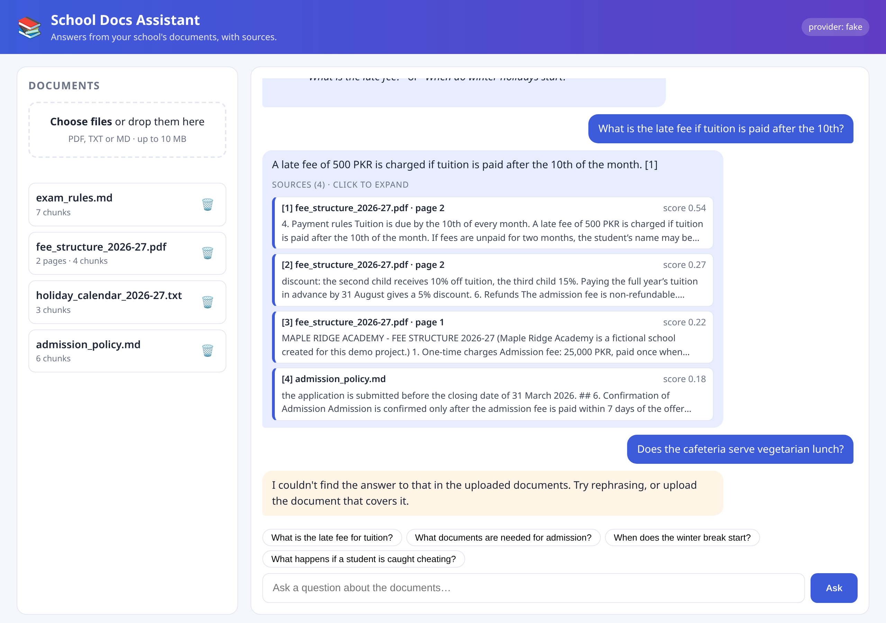
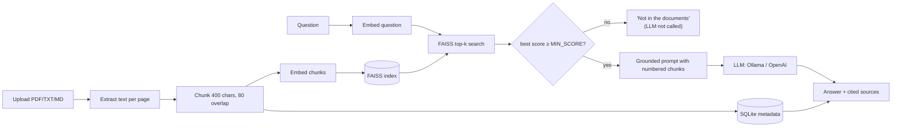

<div align="center">

# 📚 School Docs Assistant

**Ask questions about your school's documents and get answers that cite the exact file and page.**

[](https://www.python.org/)
[](https://fastapi.tiangolo.com/)
[](https://github.com/ahsannafees903/school-docs-rag-assistant/actions/workflows/ci.yml)
[](LICENSE)

</div>

Parents ask the same questions every term: *What's the late fee? Which documents do I need
for admission? When does winter break start?* The answers are in PDFs nobody reads.
**School Docs Assistant** is a retrieval-augmented generation (RAG) chatbot: upload the
admission policy, fee structure, exam rules and holiday calendar, then ask in plain English.
Every answer comes with its sources, and if the documents don't cover the question it says
so instead of making something up.


<sub>Screenshot taken with the offline `fake` provider, which answers by quoting the retrieved text.</sub>

## ✨ Features

- **Upload PDF, TXT or Markdown.** Text is extracted per page with `pypdf`, split into
  overlapping chunks and embedded.
- **Answers with citations:** document name, page number (for PDFs), snippet and similarity score.
- **Grounded by design.** Below a similarity threshold the assistant refuses *before*
  calling the LLM, and the system prompt forbids going beyond the retrieved context.
- **Pluggable models:** run fully local with **Ollama** (`llama3` + `nomic-embed-text`) or use
  **OpenAI** (`gpt-4o-mini` + `text-embedding-3-small`), chosen with one env var.
- **Offline fake provider** so the whole test suite and CI run with no API keys or network.
- **FAISS vector index + SQLite metadata**, persisted to disk; deleting a document removes exactly its vectors.
- **One JSON envelope for every response**, errors included ([API standards](docs/API_STANDARDS.md)).
- **Single-page chat UI** (plain HTML/JS, no build step) with drag-and-drop upload.
- **Retrieval eval script** reporting hit rate and refusal rate, plus a threshold sweep.
- Structured JSON logs, type hints, ruff, pytest, GitHub Actions, Docker + docker-compose.

## 🏗️ How it works



More detail: [docs/ARCHITECTURE.md](docs/ARCHITECTURE.md) · design trade-offs:
[docs/DECISIONS.md](docs/DECISIONS.md).

## 🚀 Quickstart

Requires Python 3.11+.

```bash
git clone https://github.com/ahsannafees903/school-docs-rag-assistant.git
cd school-docs-rag-assistant
python -m venv .venv && source .venv/bin/activate   # Windows: .venv\Scripts\activate
pip install -e ".[dev]"
cp .env.example .env
```

### Option A: local models with Ollama (free, private)

```bash
# install Ollama from https://ollama.com, then:
ollama pull llama3
ollama pull nomic-embed-text
# .env: PROVIDER=ollama
```

### Option B: OpenAI

```bash
# .env: PROVIDER=openai and OPENAI_API_KEY=sk-...
```

### Option C: try it offline in 10 seconds

```bash
# .env: PROVIDER=fake   (no model needed; lexical search + extractive answers)
```

### Run

```bash
python scripts/ingest_samples.py                 # load the 4 sample school documents
uvicorn app.main:create_app --factory --reload   # open http://localhost:8000
```

Interactive API docs: http://localhost:8000/docs

### Docker

```bash
docker compose up -d                                   # app + Ollama
docker compose exec ollama ollama pull llama3
docker compose exec ollama ollama pull nomic-embed-text
```

## 🔌 API

All responses use `{"status": "success"|"error", "data": ..., "error": null|{"code", "message"}}`.

| Method | Path | Purpose |
|---|---|---|
| `GET` | `/health` | Service status and active provider |
| `POST` | `/documents` | Upload a PDF/TXT/MD file (multipart field `file`) |
| `GET` | `/documents` | List uploaded documents |
| `DELETE` | `/documents/{id}` | Delete a document and its vectors |
| `POST` | `/chat` | Ask a question and get an answer with sources |

```bash
curl -F "file=@sample_docs/fee_structure_2026-27.pdf" http://localhost:8000/documents

curl -X POST http://localhost:8000/chat \
  -H "Content-Type: application/json" \
  -d '{"question": "What is the late fee if tuition is paid after the 10th?"}'
```

Real response (fake provider, all 4 sample docs loaded, sources trimmed to one):

```json
{
  "status": "success",
  "data": {
    "answer": "A late fee of 500 PKR is charged if tuition is paid after the 10th of the month. [1]",
    "grounded": true,
    "sources": [
      {
        "document_id": "faa04198e31c",
        "document_name": "fee_structure_2026-27.pdf",
        "page": 2,
        "snippet": "4. Payment rules Tuition is due by the 10th of every month. A late fee of 500 PKR is charged if tuition is paid after the 10th of the month. …",
        "score": 0.5443
      }
    ]
  },
  "error": null
}
```

Out-of-scope question:

```json
{"status": "success",
 "data": {"answer": "I couldn't find the answer to that in the uploaded documents. Try rephrasing, or upload the document that covers it.",
          "grounded": false, "sources": []},
 "error": null}
```

Error example:

```json
{"status": "error", "data": null,
 "error": {"code": "UNSUPPORTED_FILE_TYPE", "message": "'x.png' is not supported. Allowed types: .md, .pdf, .txt."}}
```

## ⚙️ Configuration

Set in `.env` (see [`.env.example`](.env.example)):

| Variable | Default | Meaning |
|---|---|---|
| `PROVIDER` | `fake` | `fake`, `ollama` or `openai` |
| `OPENAI_API_KEY` | (empty) | Required for `openai` |
| `OLLAMA_BASE_URL` | `http://localhost:11434` | Ollama server |
| `CHUNK_SIZE` / `CHUNK_OVERLAP` | `400` / `80` | Characters per chunk / overlap |
| `TOP_K` | `4` | Chunks retrieved per question |
| `MIN_SCORE` | provider default | Cosine threshold below which the assistant refuses |
| `DATA_DIR` | `data` | Where `index.faiss` and `metadata.db` live |
| `MAX_UPLOAD_MB` | `10` | Upload size limit |

## 🗂️ Project structure

```
app/
  main.py            FastAPI app factory, routes, request logging
  envelope.py        JSON envelope + exception handlers
  config.py          Settings (pydantic-settings)
  ingestion.py       Text extraction and chunking
  store.py           SQLite metadata + FAISS index
  rag.py             Ingest / retrieve / grounded answer
  prompts.py         System prompt and context formatting
  providers/         base interfaces, fake, ollama, openai
  static/            Chat UI (HTML/CSS/JS)
sample_docs/         4 fictional school documents (MD, TXT, 2-page PDF)
scripts/             ingest_samples.py, eval.py, simple_pdf.py, build_sample_pdf.py
eval/questions.json  24 eval questions (20 answerable, 4 out-of-scope)
tests/               pytest suite (runs offline)
docs/                architecture, API standards, decisions, screenshot
```

## 🧪 Testing

```bash
ruff check . && ruff format --check .
pytest -q
```

58 tests cover chunking, PDF/TXT/MD ingestion, persistence across restarts, deletion,
retrieval ranking and page numbers, grounding and refusal (including "the LLM is never
called below the threshold"), the Ollama and OpenAI clients against mocked HTTP, and the
response envelope on every success and error path.
None of them need API keys, a running model or network access.

## 📏 Evaluation

```bash
python scripts/eval.py           # metrics for the configured provider
python scripts/eval.py --sweep   # hit rate / refusal rate across thresholds
```

Measured result with the **fake** provider (`CHUNK_SIZE=400`, `TOP_K=4`, `MIN_SCORE=0.15`):

| Metric | Value |
|---|---|
| hit@1 (right document is the top source) | 95% (19/20) |
| hit@4 | 95% (19/20) |
| page hit@4 (PDF questions with a known page) | 80% (4/5) |
| refusal rate on out-of-scope questions | 100% (4/4) |

This is a small, hand-written set on a lexical stand-in embedder, so treat it as a regression
check, not a benchmark. The margin is thin: the weakest answerable question and the
strongest out-of-scope question both scored 0.132. Run it with `PROVIDER=ollama` or
`PROVIDER=openai` to tune `MIN_SCORE` for a real embedding model (I haven't published
numbers for those yet).

## 🛣️ Roadmap

- [ ] Publish eval numbers for Ollama and OpenAI embeddings
- [ ] Streaming answers (server-sent events)
- [ ] Hybrid search (BM25 + vectors) and a re-ranker
- [ ] OCR for scanned PDFs
- [ ] Urdu question support
- [ ] Per-school collections and simple API-key auth
- [ ] Conversation memory for follow-up questions

## 👤 Author

**M Ahsan Nafees**, Python backend and AI engineer

- GitHub: [@ahsannafees903](https://github.com/ahsannafees903)
- Portfolio: [mashannafees.vercel.app](https://mashannafees.vercel.app/)

The sample documents describe **Maple Ridge Academy, a fictional school** invented for
this demo. Any resemblance to a real school's policies is coincidental.

## 📄 License

[MIT](LICENSE)
