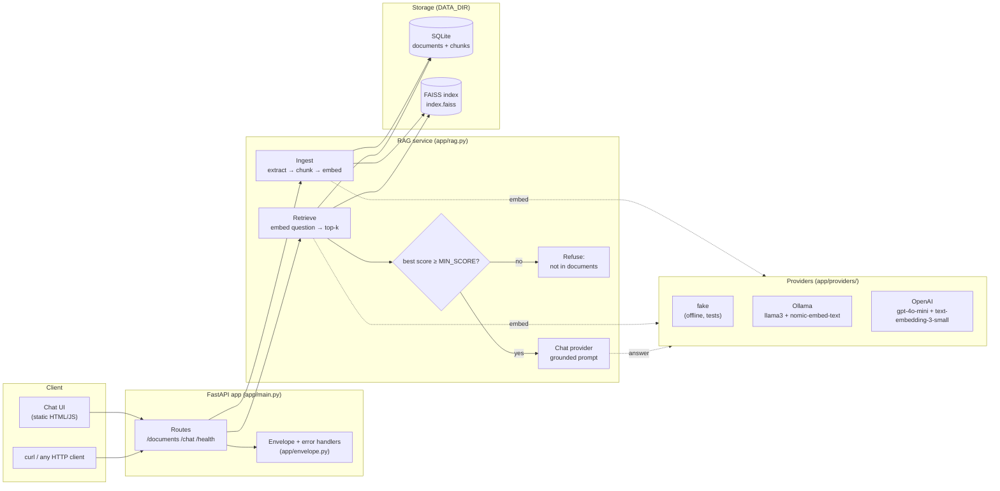

# Architecture

## Modules

| Module | Responsibility |
|---|---|
| `app/main.py` | `create_app()` factory: routes, request-logging middleware, static UI |
| `app/envelope.py` | `success()` / `error()` helpers and exception handlers (one JSON shape) |
| `app/config.py` | `Settings` (pydantic-settings), read from env / `.env` |
| `app/ingestion.py` | PDF/TXT/MD text extraction (pypdf), normalisation, overlapping chunking |
| `app/store.py` | `VectorStore`: SQLite metadata + FAISS `IndexIDMap2(IndexFlatIP)` on disk |
| `app/rag.py` | `RAGService`: ingest, list, delete, retrieve, answer (grounding logic lives here) |
| `app/prompts.py` | System prompt and context formatting for real LLMs |
| `app/providers/` | `EmbeddingProvider` / `ChatProvider` interfaces + fake, Ollama, OpenAI |
| `app/static/` | Single-page UI, no build step |
| `scripts/` | Sample ingest, retrieval eval, tiny PDF writer for fixtures |

## Request flows

**Upload** `POST /documents`
1. Validate extension (`.pdf/.txt/.md`) and size (`MAX_UPLOAD_MB`).
2. Extract text per page (PDF) or as one page (TXT/MD); reject if no text.
3. Split each page into ~`CHUNK_SIZE` character chunks with `CHUNK_OVERLAP`, snapping to
   paragraph/sentence/word boundaries. Chunks remember their page number.
4. Embed all chunks in one batch call.
5. Insert document + chunk rows in SQLite; add vectors to FAISS using the chunk row id as
   the vector id; write the index to disk atomically (`.tmp` then rename).

**Chat** `POST /chat`
1. Embed the question and search FAISS for `TOP_K` nearest chunks (cosine similarity).
2. Drop chunks below `MIN_SCORE`. If none remain, return the fixed "not in the documents"
   answer **without calling the LLM** (no tokens spent, no chance to hallucinate).
3. Otherwise number the chunks `[1]..[n]`, send them with the strict system prompt, and
   return the answer plus the cited sources (document, page, snippet, score).
4. If the LLM itself replies with the refusal sentence, sources are cleared and
   `grounded` is `false`.

**Delete** `DELETE /documents/{id}` removes the rows and exactly that document's vectors
(`remove_ids`), then persists the index.

## Consistency

- One `threading.RLock` guards FAISS mutations and searches; SQLite connections are
  short-lived per operation.
- The store records which embedder (`name:dimension`) built the index and refuses to open
  it with a different one (`INDEX_MISMATCH`), because mixing embedding spaces silently
  returns garbage.
